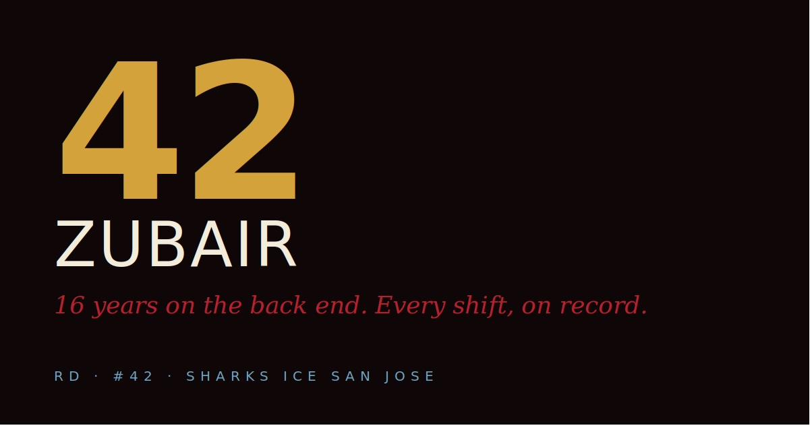

  

<h1 align="center">zubair-42</h1>

<em>Beer-league hockey, audited.</em>

**1,290 games. 17 years. 74 teams.** The full statistical record of #42 — right defense,
Sharks Ice San Jose — and the conditioning that keeps it going.

This is a personal hockey + health dashboard: every season, every game, every penalty minute,
alongside cardio volume, recovery and per-game rates. Not a sample. The whole career.

## What's inside

- **Career view** — every season since the beginning, 74 teams' worth of stats in one place.
- **Per-game rates and rolling form** — the last 10 games against the career baseline.
- **Volume + cardio** — games played as training load, with the health data next to the
  hockey it pays for.
- **Penalty minutes** — on the record like everything else.

## How it's built

One self-contained HTML file — markup, styles, logic and sixteen years of data, all inline.
No framework, no build step, no server. Open `index.html` and the entire record is there.

The dashboard is versioned like a product (currently **v18h**): each data refresh is a
commit, so the record carries its own audit trail.

## Author

**Zubair Jeewanjee** — the same hands behind
[Zubissou Sounds](https://github.com/zubairjeewanjee-42/zubissou), a feel-based music
curation engine. Different rink, same principle: *if a number matters, it gets tracked; if
it's tracked, it gets designed.*
